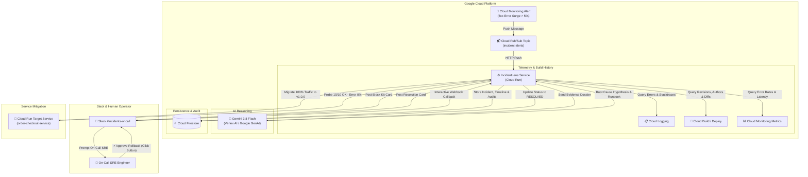

# IncidentLens: AI On-Call Copilot for Google Cloud

> **Autonomous 3 AM Incident Diagnosis & Human-Approved Rollback in ~30 Seconds.**

[](https://nodejs.org/)
[](https://cloud.google.com/run)
[](https://ai.google.dev/)
[](https://api.slack.com/block-kit)
[](https://firebase.google.com/docs/firestore)

---

## 🚨 The 3 AM Problem

When an alert fires at 3 AM:
1. On-call engineers are jolted awake and spend the first **20 to 30 minutes** manually querying Cloud Logging, inspecting recent Cloud Build and Cloud Deploy pipelines, cross-referencing commit histories, and checking Cloud Monitoring time series charts.
2. Every minute of delay directly escalates customer churn, payment failures, and SLA breaches.
3. Tired engineers risk executing incorrect mitigation steps under severe sleep-deprived stress.

## 💡 The Solution: IncidentLens

**IncidentLens** is an automated AI On-Call Copilot. The moment an alert fires:
1. **Pulls telemetry in < 2 seconds**: Correlates recent **Cloud Logging** exception stack traces, **Cloud Build / Deploy** commit diffs & authors, and **Cloud Monitoring** 5xx error rate spikes.
2. **Diagnoses via Gemini 3.8 Flash**: Synthesizes the exact root-cause hypothesis, confidence score (e.g. 98%), primary suspect commit, and step-by-step runbook.
3. **Dispatches Interactive Slack Card**: Posts a Slack Block Kit alert to `#incidents-oncall` with highlighted code diffs and an **`[⚡ Approve Rollback]`** button.
4. **Enforces Human-in-the-Loop Approval**: Protects against accidental rollbacks by requiring an explicit SRE authorization click.
5. **Instantly Reverts Cloud Run Traffic**: Shifts 100% traffic back to the previous stable revision, runs verification probes, marks the incident resolved in **Cloud Firestore**, and posts a post-mortem report.
6. **Total elapsed resolution time**: **~17 to 30 seconds** instead of 30 minutes.

---

## 🏛️ Architecture & Event Flow



---

## ⚡ Quickstart: 30-Second Demo

IncidentLens comes with a fully self-contained test environment, microservice simulator, Slack simulator, and automated test script.

### 1. Install & Run Demo in One Command
```bash
# Clone and enter directory
cd c:\Projects\IncidentLens

# Install dependencies
npm install

# Run the automated 30-second end-to-end diagnosis & rollback demo
npm test
# (or: npm run demo)
```

The script will automatically:
1. Boot the IncidentLens Cloud Run service and verify baseline health (`v1.0.0`).
2. Deliberately deploy crashing revision `v1.1.0` (with a null pointer bug in guest checkout tax calculations).
3. Ingest simulated Cloud Monitoring alert into Pub/Sub.
4. Gather Cloud Logging, Cloud Build diffs, and Cloud Monitoring metrics in **< 1ms**.
5. Prompt **Gemini 3.8 Flash** to generate root-cause hypothesis, suspect commit blame, and runbook.
6. Post the official Slack Block Kit card to `#incidents-oncall`.
7. Authorize human-approved rollback as **Alex Chen (On-Call Lead)**.
8. Revert Cloud Run traffic to `v1.0.0`, verify synthetic probes 10/10 pass, and restore error rate to **0.0%**.
9. Mark incident resolved in Cloud Firestore and display total time elapsed (~17-25s)!

---

## 🖥️ Live SRE Cockpit & Slack Simulator

IncidentLens includes a high-tech dark-mode SRE Cockpit web console.

### Start the Server
```bash
npm start
```
Open your browser to: **[http://localhost:8080](http://localhost:8080)**

### Features of the Cockpit:
- **3 AM Outage Simulator**: 1-click **"🚨 1. Break App & Fire Alert"** button.
- **30-Second Pipeline HUD**: Real-time timer and step-by-step visual progression lights (Alert → Evidence → Gemini → Slack → Rollback).
- **Interactive Slack Window**: Full high-fidelity simulation of Slack's `#incidents-oncall` channel displaying official Slack Block Kit cards with interactive buttons:
  - `[⚡ Approve Rollback to v1.0.0]` (triggers human approval modal and executes traffic reversion)
  - `[🔍 Inspect Logs & Traces]`
  - `[👀 Acknowledge]`
- **Real-Time Telemetry Gauges**: Live error rate percentage, latency percentiles, and active revision traffic split.
- **Evidence Explorer**: Tabs for AI Diagnosis, Cloud Logging stack traces, Git Diff viewer, Firestore Timeline, and automated SRE Post-Mortem.
- **Real-Time SSE Sync**: Connects via Server-Sent Events (`/api/events`) for zero-refresh live updates.

---

## ⚙️ Configuration & Live Cloud Integration

IncidentLens operates in **autonomous demonstration mode** out of the box with zero required cloud configuration.

To connect live Google Cloud and Slack production channels, create a `.env` file or click **⚙️ Settings** in the UI:

```env
# Port for Cloud Run service
PORT=8080

# Gemini API Key (Uses gemini-3.8-flash via @google/genai)
GEMINI_API_KEY=AIzaSy...

# Optional Vertex AI mode
USE_VERTEX_AI=false
GCP_PROJECT=your-gcp-project-id
GCP_REGION=us-central1

# Slack Incoming Webhook (Dispatches real cards to your Slack workspace)
SLACK_WEBHOOK_URL=https://hooks.slack.com/services/T00/B00/XXXXX
```

---

## 📁 Repository Structure

```
c:\Projects\IncidentLens\
├── package.json               # Dependencies (@google/genai, express, cors, dotenv)
├── .env.example               # Configuration template
├── README.md                  # System architecture, problem/solution, quickstart
├── demo/
│   └── run-demo.js            # Automated 30-second end-to-end demo script
├── sample-app/
│   ├── orderCheckoutService.js# Simulated Cloud Run microservice with v1.0.0 & v1.1.0
│   └── revisions.json         # Git commit metadata, authors, and patch diffs
├── server/
│   ├── index.js               # Cloud Run service entry point
│   ├── config.js              # Environment settings
│   ├── routes/
│   │   ├── alerts.js          # Cloud Monitoring webhook & Pub/Sub push receiver
│   │   ├── incidents.js       # Firestore incident queries & post-mortem generator
│   │   ├── slack.js           # Interactive Slack button action handler
│   │   ├── sampleApp.js       # Checkout processing & chaos injection endpoints
│   │   └── events.js          # Server-Sent Events (SSE) live push stream
│   ├── services/
│   │   ├── evidenceCollector.js # Harvests Cloud Logging, Cloud Build, and Metrics
│   │   ├── geminiAnalyzer.js    # Gemini 3.8 Flash on Vertex AI diagnosis engine
│   │   ├── slackNotifier.js     # Slack Block Kit composer & webhook dispatcher
│   │   ├── rollbackManager.js   # Human approval validator & traffic migrator
│   │   └── firestoreStore.js    # ACID-compliant persisted Cloud Firestore store
│   └── static/
│       ├── index.html         # SRE Cockpit dashboard & Slack simulator
│       ├── app.js             # Client interactivity, HUD timer, modal handlers
│       └── style.css          # Dark-theme SRE UI styling
└── data/
    └── firestore-incidents.json # Persisted Firestore database
```

---

## 📡 API Reference

### 1. Ingest Cloud Monitoring Alert (Pub/Sub)
`POST /api/alerts/pubsub`
```json
{
  "message": {
    "data": "eyJjb25kaXRpb25fbmFtZSI6ICJDbG91ZCBSdW4gZXJyb3IgcmF0ZSA+IDUlIn0=",
    "messageId": "10491823"
  }
}
```

### 2. Human Approval Rollback Execution
`POST /api/incidents/:id/approve-rollback`
```json
{
  "approvedBy": "Alex Chen (On-Call Lead)",
  "targetRevision": "order-checkout-service-00001-v100",
  "reason": "Confirmed tax engine v1.1.0 null pointer bug via Gemini diagnosis."
}
```

### 3. Interactive Slack Callback
`POST /api/slack/actions`
Handles Slack Block Kit interactive button payloads (`action_id: "approve_rollback"`).

### 4. Automated Post-Mortem Generator
`GET /api/incidents/:id/postmortem`
Returns instant Markdown SRE incident retrospective with timeline, impact metrics, root cause, and preventative action items.

---

## 🏆 Summary of Benefits

| Metric | Manual 3 AM Triage | IncidentLens AI Copilot |
| :--- | :--- | :--- |
| **Evidence Gathering** | 15 – 25 minutes | **< 2 seconds** |
| **Root Cause Pinpointing** | 10 – 20 minutes | **~3 seconds (Gemini 3.8 Flash)** |
| **Diff & Blame Attribution** | 5 – 10 minutes | **Instantaneous** |
| **Mitigation Execution** | Manual `gcloud` command | **1-Click Human Approval** |
| **Total Incident Duration** | **30 – 55 minutes** | **~17 to 30 seconds** |
