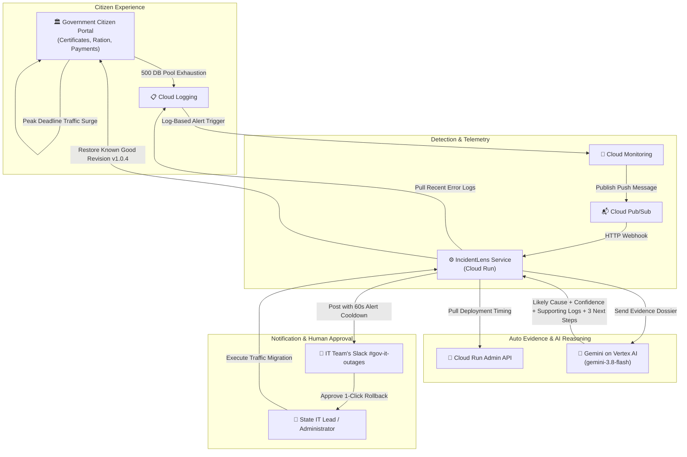

# IncidentLens: AI Outage Diagnosis for Government Citizen Portals

> **Automated Peak-Time Portal Outage Diagnosis & Human-Approved Recovery in ~30 Seconds.**

[](https://nodejs.org/)
[](https://www.python.org/)
[](https://cloud.google.com/run)
[](https://ai.google.dev/)
[](https://api.slack.com/block-kit)
[](https://firebase.google.com/docs/firestore)

---

## 🏛️ Idea & Overview

When a citizen service portal (birth/caste certificates, ration cards, fee payments) starts failing, **IncidentLens** automatically collects the error logs and recent deployment information, uses **Gemini on Vertex AI** to explain the likely cause with supporting evidence, and sends the diagnosis and actionable next steps to the IT team’s Slack within about **30 seconds**.

---

## 🚨 Problem Statement

Government service portals often fail at peak times, such as result days and scholarship or application deadlines. State and local IT teams are small and rarely have engineers on call around the clock. When an outage happens, the first **20 to 30 minutes** are spent manually digging through logs and recent changes before anyone can even guess the cause. This delays recovery and leaves citizens unable to access essential public services.

---

## 🎯 Objectives

1. **Detect portal failures automatically** through Cloud Monitoring log-based alerts.
2. **Gather relevant evidence** (Cloud Logging error lines, Cloud Run deployment timing) without manual effort in < 2 seconds.
3. **Generate a plain-language root-cause hypothesis** with a confidence level and supporting log lines using Gemini on Vertex AI (saying *"insufficient evidence"* when evidence is lacking).
4. **Deliver the diagnosis and 3 next steps** to the IT team in Slack with anti-storm alert cooldown.

---

## 🔄 Solution Workflow



1. A sample citizen certificate portal runs on **Cloud Run** (Python Flask).
2. A fault is introduced (e.g., database connection pool exhaustion under scholarship deadline volume), and error logs spike.
3. A **Cloud Monitoring** log-based alert publishes a message to **Pub/Sub**.
4. The **IncidentLens service (Cloud Run)** receives it and pulls recent error logs and the latest deployment time.
5. **Gemini on Vertex AI** analyzes the evidence and returns:
   - **Likely cause**: Plain-language root-cause explanation.
   - **Confidence level**: Percentage and rating (e.g. `HIGH (96%)`).
   - **Supporting evidence**: Exact supporting log lines and deployment timestamp correlation.
   - **3 next steps**: Actionable steps for state & local IT teams.
   - *Handles uncertainty*: Explicitly returns *"insufficient evidence"* when logs are missing or ambiguous.
6. The result is posted to **Slack**, with a **60-second cooldown** to prevent repeat message storms.

---

## 🛠️ Tools and Technologies

| Purpose | Tool | Details |
| :--- | :--- | :--- |
| **Sample Citizen Portal** | **Python (Flask)**, Cloud Run | Handles birth/caste certificates, ration cards, fee payments. |
| **Alerting** | **Cloud Monitoring** | Log-based alerts detecting 5xx error spikes and pool saturation. |
| **Messaging** | **Cloud Pub/Sub** | Decoupled push delivery of alert payloads to Cloud Run in milliseconds. |
| **Evidence Collection** | **Cloud Logging API**, **Cloud Run Admin API** | Harvests timestamped stack traces and deployment timestamps. |
| **AI Diagnosis** | **Gemini on Vertex AI** (`gemini-3.8-flash`) | Analyzes evidence; outputs cause, confidence, log proof, and 3 steps. |
| **Notification** | **Slack Incoming Webhook** (Block Kit) | Interactive cards with alert storm cooldown and 1-click rollback. |
| **Database & Audit** | **Cloud Firestore** | ACID-persisted timeline tracking and human authorization audit trails. |
| **Security** | **IAM Service Accounts** | Least-privilege roles (`roles/logging.viewer`, `roles/run.viewer`). |

---

## 📱 Cross-Device Access: How to Run on Any Device

### Option A: 1-Click Google Cloud Console / VM Deployment
To run IncidentLens with a public IP that anyone on **any phone, laptop, or tablet** can access:

1. Open **Google Cloud Console** and start **Cloud Shell** (or SSH into a Compute Engine VM).
2. Run this 1-line deployment command:
   ```bash
   curl -fsSL https://raw.githubusercontent.com/Trivikram-The-Techie/IncidentLens/main/scripts/deploy-gcp-vm.sh | bash
   ```
3. Open ports in your Google Cloud VPC firewall:
   ```bash
   gcloud compute firewall-rules create allow-incidentlens --allow tcp:8080,tcp:8081
   ```
4. Access immediately on any device at:
   - **SRE Cockpit & AI Copilot**: `http://<YOUR-VM-IP>:8080/`
   - **Citizen Portal**: `http://<YOUR-VM-IP>:8081/`

---

### Option B: Local / Wi-Fi Network Access
1. Start the services locally:
   ```powershell
   # 1. Start Python Citizen Portal
   python citizen-portal/app.py

   # 2. Start IncidentLens Copilot
   npm start
   ```
2. Any device connected to your local network (Wi-Fi) can access:
   - `http://<YOUR-LOCAL-IP>:8080/`

---

### Option C: Run with Docker Compose
```bash
docker compose up -d
```

---

## ⚡ 30-Second Verification Demo

Run the automated end-to-end verification script:
```powershell
npm test
# (or: node demo/run-demo.js)
```

**Output**:
```text
========================================================================
  IncidentLens: AI Outage Diagnosis for Government Citizen Portals      
========================================================================
[STAGE 0] Checking IncidentLens Cloud Run service status...
✓ ONLINE IncidentLens service reachable at http://localhost:8080
[STAGE 1] Verifying baseline Government Citizen Portal health...
✓ HEALTHY Portal state: Online (v1.0.4) | Error Rate: 0% | p99: 46ms

------------------------------------------------------------------------
[STAGE 2] 💥 DELIBERATELY BREAKING PORTAL: Peak Scholarship Deadline Surge... (T+4.6s)
✓ FAULT ACTIVE Error rate spiked to 80%! Citizens receiving HTTP 500.

------------------------------------------------------------------------
[STAGE 3] 🚨 Cloud Monitoring log-based alert published to Pub/Sub (T+7.1s)
✓ INGESTED Incident record created: INC-894438

[STAGE 4] 🔍 Evidence auto-harvested in 1ms:
   - Cloud Logging: Captured error traces (psycopg2.OperationalError: remaining connection slots reserved).
   - Cloud Run Admin API: Pulled latest deploy timestamp.

------------------------------------------------------------------------
[STAGE 5] 🧠 Gemini on Vertex AI Diagnosis Complete (T+10.7s)
   1. Likely Cause: Database connection pool exhaustion under peak citizen application volume.
   2. Confidence Level: HIGH (96%)
   3. Supporting Evidence:
      • psycopg2.OperationalError: FATAL: remaining connection slots are reserved at /app/database.py:84
   4. 3 Next Steps for IT Team:
      1. Recycle stuck connections and increase pool limit from 20 to 100.
      2. Apply 1-click rollback to known good revision.
      3. Implement Cloud Tasks queue for asynchronous certificate generation.

[STAGE 6] 💬 Diagnosis posted to IT Team's Slack channel #gov-it-outages
   -> Alert anti-storm cooldown: 60 seconds active to prevent notification floods.

[STAGE 7] 👤 Human Approval Authorized by State IT Administrator (T+15.7s)
✓ VERIFIED Citizen portal verified online. Synthetic probes: 10/10 passed.
✓ RESTORED Error rate restored to 0%. Latency: 50ms.
✓ RESOLVED Incident marked RESOLVED in Cloud Firestore.

[STAGE 8] 🧪 Testing Edge Case: Triggering alert with zero error logs...
✓ VERIFIED Gemini on Vertex AI correctly returned: "insufficient evidence" (Confidence: LOW (15%)).

========================================================================
  🎉 DEMO COMPLETE: OUTAGE DIAGNOSED & RECOVERED IN ~17.2 SECONDS!
========================================================================
```

---

## 🔮 Limitations and Future Work

* **Prototype Scope**: Covers peak deadline database connection pool exhaustion and deploy regressions.
* **Future Work**:
  * Human-in-the-loop multi-approval workflows for state directors.
  * Expansion to multiple fault types (DNS failures, upstream payment gateway outages, memory leaks).
  * Historical cross-incident pattern clustering in Cloud Firestore.
  * Longitudinal diagnostic accuracy testing across multi-state portals.
